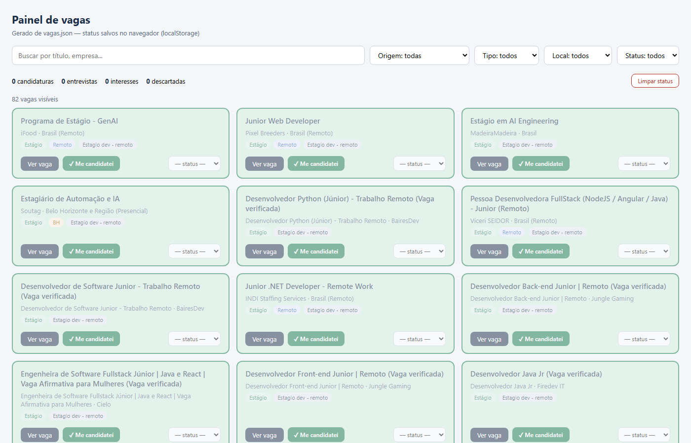

# linkedin-vagas-bot

Automação de busca de emprego: coleta vagas no LinkedIn, organiza num
painel kanban e mapeia formulários de candidatura. Feito para uso
pessoal na minha própria busca por estágio/junior.



## O que faz

| Componente | Função |
|---|---|
| `bot/vagas_linkedin.py` | Navega o LinkedIn com sessão persistente, roda buscas parametrizadas (cargo + local + filtros), extrai vagas e grava `painel/vagas.json` |
| `painel/gerar_painel.py` | Gera `vagas.html` — kanban com filtros (texto, tipo, local, origem) e status por vaga (Interesse → Candidatado → Entrevista → Descartado) salvos no navegador |
| `tools/mapear_form.py` | Abre um formulário de candidatura e despeja todos os campos e opções de seleção (útil para responder perguntas com precisão) |

## Detalhe técnico

O LinkedIn migrou para uma UI de busca com classes CSS ofuscadas
(`ajrax7`, `ajrluf`...) que mudam constantemente — seletores por
classe quebram. Em vez disso, cada card de vaga carrega o atributo
`componentkey="job-card-component-ref-<id>"`, de onde o ID da vaga
sai direto, sem cliques:

```python
m = re.search(r"job-card-component-ref-(\d+)", it["key"])
link = f"https://www.linkedin.com/jobs/view/{m.group(1)}"
```

## Como usar

```bash
pip install playwright
python -m playwright install chromium

# 1. login uma vez (abre o Chrome, sessão fica salva em bot/li_profile_chrome)
python bot/vagas_linkedin.py login

# 2. buscar vagas (edite a lista BUSCAS no script para suas queries)
python bot/vagas_linkedin.py buscar

# 3. gerar o painel
python painel/gerar_painel.py   # abre painel/vagas.html

# extra: mapear um formulário de candidatura
python tools/mapear_form.py "https://url-da-vaga"
```

## Estrutura

```
bot/        scraper + sessão persistente do navegador
painel/     gerador do kanban HTML
tools/      mapeador de formulários
docs/       guia detalhado e assets
examples/   amostra real de saída (vagas.sample.json)
```

## Aviso

Projeto pessoal para fins de estudo e uso próprio. Respeite os
Termos de Serviço das plataformas, use com moderação e mantenha
pausas entre requisições — o bot foi desenhado para operar em
ritmo de uso humano.

## Stack

Python · Playwright · HTML/CSS/JS vanilla · localStorage
